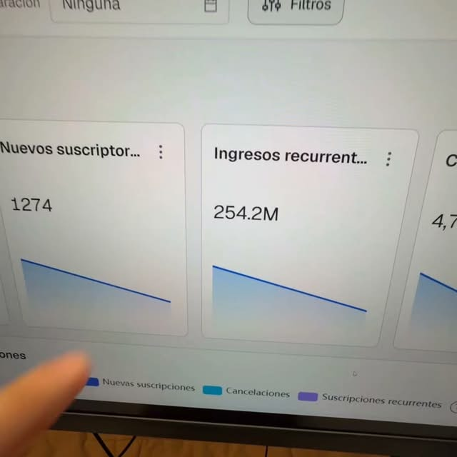

# Guiones de los ads ganadores · clase del 19/10

Los dos anuncios de adquisición que mejor rindieron en los días efectivos (18/10 y 19/10): **D3_V6** y **D4_V3**. Cada guion está transcripto palabra por palabra del video que corrió en Meta. Las correcciones de palabras que el audio no deja claras van entre corchetes.

Datos de Meta Ads y de los leads de GHL bajados del tracker el 25/10. Calificado = invierte USD 100 por día o más en Meta (criterio de la landing). Valor esperado: cada asistente a la clase vale el 2,75% de un ticket promedio de USD 3.840 (3 compradores sobre 109 asistentes de la clase del 19/10).

## Comparación rápida

| | D3_V6 | D4_V3 |
|---|---|---|
| Duración del video | 2:14 | 1:01 |
| Ángulo | Metadependencia: facturar sin pautar | Margen y recompra: los sistemas para que te vuelvan a comprar |
| Inversión total | USD 653 | USD 351 |
| Leads · calificados | 129 · 21 | 44 · 13 |
| CPL · CPL calificado | USD 5,06 · USD 31,10 | USD 7,98 · USD 27,01 |
| % que califica | 16% | 30% |
| Asistieron a la clase | 25 | 12 |
| **Solo 18 y 19/10** | | |
| Inversión | USD 317 | USD 243 |
| Leads · calificados · asistentes | 72 · 9 · 15 | 30 · 8 · 8 |
| Por cada USD 100 | 22,7 leads · 2,8 calificados · 4,7 asistentes | 12,3 leads · 3,3 calificados · 3,3 asistentes |
| CPL · CPL calificado | USD 4,41 · USD 35,27 | USD 8,10 · USD 30,38 |
| Costo por asistente | USD 21 | USD 30 |
| ROAS esperado | 5,0x | 3,5x |

---

## D3_V6 · «Facturé 220 millones sin poner un dólar en Meta»

### Datos de campaña

| Campaña | Conjunto | Anuncio | Fechas | Días |
|---|---|---|---|---|
| ADQUISICION \| ABO \| 19/10 - GOAT | CA 17 \| D3_V6 | AD 17 \| D3_V6 | 16/10 al 19/10 | 4 |
| ADQUISICION \| ABO \| 19/10 - CHECK | CA 17 \| D3_V6 | AD 17 \| D3_V6 | 13/10 al 14/10 | 2 |
| ADQUISICION \| ABO \| 19/10 - GOAT | CA 17 \| D3_V6 ///// ERROR | AD 17 \| D3_V6 ///// ERROR | 15/10 | 1 |

El mismo video corrió también como **AD 1** en la prueba de bid cap (ADQUISICION | BIDCAP INSANA | 19/10 - MENTORES CULO ROTO), del 17/10 al 19/10.

### Métricas por anuncio

| Anuncio | Inversión | Impresiones | Alcance | Frec. | Clics | CTR | CPM | CPC | Clic → landing | Visitas | Leads | Conv. landing | Calificados | CPL | CPL calif. | Asistieron | Aplicaron |
|---|---|---|---|---|---|---|---|---|---|---|---|---|---|---|---|---|---|
| GOAT · AD 17 | USD 545,68 | 43.196 | 34.747 | 1,24 | 969 | 2,2% | USD 12,63 | USD 0,56 | 85,4% | 828 | 116 | 14,0% | 21 | USD 4,70 | USD 25,98 | 24 | 2 |
| CHECK · AD 17 | USD 64,74 | 5.675 | 4.865 | 1,17 | 125 | 2,2% | USD 11,41 | USD 0,52 | 82,4% | 103 | 13 | 12,6% | 0 | USD 4,98 | — | 1 | 0 |
| GOAT · AD 17 (ERROR) | USD 42,74 | 2.851 | 2.644 | 1,08 | 54 | 1,9% | USD 14,99 | USD 0,79 | 81,5% | 44 | 0 | 0% | 0 | — | — | 0 | 0 |
| **Total D3_V6** | **USD 653,16** | **51.722** | | | **1.148** | **2,2%** | **USD 12,63** | **USD 0,57** | **84,9%** | **975** | **129** | **13,2%** | **21** | **USD 5,06** | **USD 31,10** | **25** | **2** |
| Bid cap · AD 1 (mismo video) | USD 139,45 | 13.273 | | | 260 | 2,0% | USD 10,51 | USD 0,54 | 83,8% | 218 | 24 | 11,0% | 3 | USD 5,81 | USD 46,48 | 5 | 0 |

Ventas atribuidas directamente a este anuncio: 0. Lo que más rindió de D3_V6 fue la campaña GOAT: 116 leads y 21 calificados a USD 25,98.

### Guion (palabra por palabra)

> El mes pasado facturé 220 millones de pesos con mi ecommerce de mi producto químico sin haber puesto ni un solo dólar en Meta. Es decir, facturé 220 millones de pesos sin haber puesto un solo dólar en anuncios.
>
> Y no, la realidad es que no fue haciendo contenido orgánico, no fue con cosas raras. Lo único que hicimos fue aplicar el modelo de suscripción. Es decir, todos los meses pasados veníamos corriendo una [oferta] de suscripción donde adquirimos a todos esos clientes en un débito automático, donde todos los meses nos siguen recomprando lo que es el producto sin necesidad de seguir pagando un CPA en Meta. Entonces, todo ese margen que tenés para poder pagar esa adquisición nos entra con todo el margen entero.
>
> Hoy en día tenemos 3.200 suscriptores activos en nuestra marca que se cobran todos los meses, con una tasa de cancelaciones de menos del 5%.
>
> Y ahora pensá al revés. Si mañana vos, por ejemplo, te restringen lo que es la cuenta publicitaria, ¿cuánto seguirías facturando? Probablemente cero.
>
> Así que por eso el lunes 19 de octubre a las 19 horas voy a dar una clase privada, 100% en vivo y gratis, donde te voy a mostrar cómo es que pasé con todo lo que es mi marca de productos consumibles a lo que es el modelo de suscripción, sobre todo con el método [base]. Esto lo hago para que dejes de depender de Meta y que si se te cae la cuenta puedas seguir facturando y con márgenes altísimos. Hoy en día mi marca tiene un margen del 45%.
>
> Pero bueno, solamente pueden entrar los que entren con el link de acá abajo del video, y para todos los que entren voy a dar 3 recursos que son clave para que te [vaya] bien.
>
> Primero, el [roadmap] para migrar tu marca al modelo de suscripción sin frenar lo que hoy en día ya tenés corriendo; sobre todo que puedas utilizar lo que es tu base de clientes para transicionarlos al modelo de suscripción, y que uses las campañas y la oferta que mejor te esté funcionando para justamente adaptar eso y largarlo en el modelo de suscripción.
>
> Segundo, te voy a dar el simulador de suscripciones para que puedas cargar todos los costos de tu producto: envío, pasarelas, impuestos, etc. Y en base a eso que te dé todo un output entero de cómo se vería tu marca utilizando el modelo de suscripción, con diferentes escenarios de lifetime value. Y eso lo que te va a dar es que puedas ver proyecciones de tu marca y, sobre todo, para que en un futuro puedas tener esa estabilidad que buscás.
>
> Y tercero, te voy a dar todo un sistema de inteligencia artificial para que puedas crear lo que son los flujos de email de manera automática y que los puedas aplicar para tu marca de un momento para otro.
>
> Como te digo, esto es lo único que necesitás para que, si se te llega a caer la cuenta, puedas seguir facturando y con muchísimo margen. Así que, como te digo, reservá tu lugar: los cupos son limitados, la clase es en vivo, es privada, es el lunes 19 de octubre a las 19 horas. Registrate acá abajo y te veo ahí. Adiós.

Palabras entre corchetes: el audio dice algo parecido a «farta» (oferta), «haya» (vaya) y «rumbo/ritmo» (roadmap, por cómo se nombra el recurso en el resto de la pauta). «Método [base]» se escucha así; si el método tiene otro nombre, corregilo.

---

## D4_V3 · «250 millones el mes pasado con más de 3.600 suscriptores»

### Datos de campaña

| Campaña | Conjunto | Anuncio | Fechas | Días |
|---|---|---|---|---|
| ADQUISICION \| ABO \| 19/10 - GOAT | CA 21 \| D4_V3 | AD 21 \| D4_V3 | 16/10 al 19/10 | 4 |

### Métricas

| Inversión | Impresiones | Alcance | Frec. | Clics | CTR | CPM | CPC | Clic → landing | Visitas | Leads | Conv. landing | Calificados | CPL | CPL calif. | Asistieron | Aplicaron |
|---|---|---|---|---|---|---|---|---|---|---|---|---|---|---|---|---|
| USD 351,15 | 33.376 | 25.973 | 1,29 | 389 | 1,2% | USD 10,52 | USD 0,90 | 88,4% | 344 | 44 | 12,8% | 13 | USD 7,98 | USD 27,01 | 12 | 1 |

Ventas atribuidas directamente a este anuncio: 0.

### Guion (palabra por palabra)

> 250 millones de pesos hice el mes pasado con más de 3.600 suscriptores. Y todo lo que me tardó más de 18 meses en armar para poder tener estos sistemas y facturar esto, te los voy a [regalar] absolutamente todos.
>
> Son los sistemas para dejar de constantemente perseguir nuevos clientes y hacer que cada cliente que te compre te vuelva a comprar una y otra vez, y otra vez, y otra vez. Y por eso es que tengo más de un 40% de margen en mi propia marca.
>
> Y este lunes 19 de octubre te voy a dar una clase en vivo privada, 100% gratis, donde te voy a mostrar específicamente cómo vos podés implementar todo lo que es el modelo de suscripción, con un roadmap de la A a la Z.
>
> Te voy a dar un simulador de suscripción para que veas cómo se vería tu marca con este tipo de modelo, y que proyectes y armes buenas ofertas para poder adquirirlo. Y [tercero, te doy] un sistema de inteligencia artificial que te hace todos los flujos de email por vos. Son más de 10 flujos para lo que es marcas de suscripciones: [ya sea] pre-onboarding, lo que es el winback, pre-cobro… o sea, absolutamente todo te lo voy a hacer todo por vos.
>
> Así que nada, si no te lo querés perder, hacé clic acá abajo, registrate. Es el lunes 19 de octubre a las 19 horas. Si no te registrás, te perdés el cupo y no podés entrar. La clase es privada y es gratis.
>
> Así que, yo que vos, aprovecho, que estoy mandando un montón de data por el grupo de WhatsApp. Así que nada, te veo ahí.

Palabras entre corchetes: el audio dice algo parecido a «arreglar» (regalar), «trasero tú» (tercero, te doy) y «ya es» (ya sea).

---

## Qué tienen en común y en qué se diferencian

- **Los dos abren con una cifra de facturación en pesos y el modelo de suscripción.** D3_V6: «220 millones sin poner un dólar en Meta». D4_V3: «250 millones con más de 3.600 suscriptores».
- **D3_V6 ataca el miedo a depender de Meta** («si mañana te restringen la cuenta, ¿cuánto seguirías facturando?»). Es un dolor que siente cualquiera que pauta o que quiere pautar, y por eso trae más volumen: el mejor CTR (2,2%) y la mejor conversión de la landing (13,2%).
- **D4_V3 habla de recompra y margen** («que cada cliente te vuelva a comprar»). Es un dolor de quien ya vende, y por eso califica el doble (30% contra 16%) con la mitad de leads.
- **Los dos cierran con los mismos entregables** (roadmap, simulador de suscripciones y sistema de IA para los mails) y con la fecha y la hora de la clase.
- **Para el próximo lanzamiento:** mantener el gancho de D3_V6 y sumarle en el cuerpo un filtro de quien ya vende (por ejemplo «si ya facturás con tu marca…»), y escalar D4_V3 si se cambia el criterio de calificación a capital para invertir.
